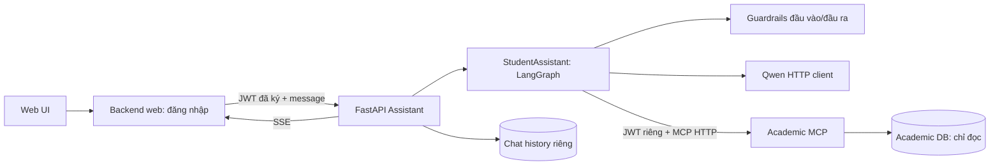

# OOAD - Hust Student Assistant
Nocodex Nochatgpt Justme

## Chatbot service

Khung student-assistant dùng FastAPI, LangGraph, MCP Streamable HTTP và SSE.
Theo tên file và thư mục hiện tại của bạn: `backend/src/services/` cho model/MCP và
`mcp/src/server.py` để khởi tạo MCP server.
Các module mới nằm cùng các package đã có; không bổ sung frontend hoặc agent manager.

- [Chạy backend, API contract và cách học code](backend/README.md)
- [MCP tools, dữ liệu giả lập và thuật toán lịch học](mcp/README.md)

Student có thể tra học phần/lớp mở/CTĐT, hồ sơ giảng viên công khai và gợi ý lịch.
Các môn chung được xác định qua quan hệ CTĐT, không chỉ tiền tố ET. Chatbot không
đăng ký lớp hoặc sửa học vụ. `admin`/`manager` trả HTTP 501; `lecturer` chưa có assistant.

Hiện dùng dữ liệu giả lập và model Qwen chạy riêng. Chưa nối database học vụ thật.
Các test tự động không gọi model thật nên chưa đánh giá chất lượng trả lời của Qwen.
